# Rediseño de Faro

Decisiones tomadas pantalla a pantalla. Las imágenes son maquetas; se aplicarán a la app cuando estén todas aprobadas.

## Principios

- Fácil para cualquier edad (de 10 a 65+), intuitiva y minimalista.
- Fondo negro, acento azul calma `#A7C7E7`, rojo `#FF6B5E` solo para pedir ayuda.
- Bordes en lugar de rellenos; letra Inter; sin jerga técnica.
- Nada de iconos pixelados. Ajustes con un engranaje claro arriba a la derecha.
- El nombre propio se cambia en Ajustes, no tocándolo en la cabecera.
- Solo grupos privados (sin subgrupos). Se entra con enlace o QR y el administrador (quien creó el grupo) acepta o rechaza.
- Cada grupo es independiente: quien está en dos grupos ve a los de ambos, pero los de un grupo no ven a los del otro.

## 1. Pantalla principal (aprobada)

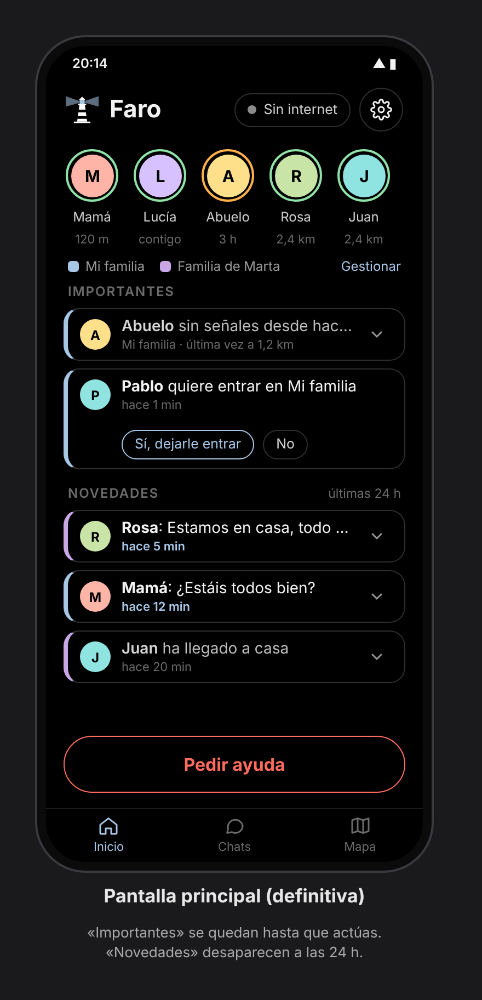

- **Cabecera:** logo y «Faro», etiqueta de conexión («● Sin internet») y engranaje de ajustes.
- **Personas:** todas las de todos tus grupos en una fila de caras con aro de estado (verde bien, naranja sin noticias), nombre y distancia o tiempo. Debajo, la leyenda de colores de cada grupo y «Gestionar».
- **Importantes** (se quedan hasta que actúes; sin texto explicativo en la cabecera del bloque): petición de ayuda, alguien sin señales, solicitud para entrar en tu grupo (con «Sí, dejarle entrar» / «No» en la propia tarjeta; solo para el administrador).
- **Novedades** (desaparecen a las 24 h; los mensajes siguen en su chat).
- Cada tarjeta lleva a la izquierda el color de su grupo. El tiempo va debajo del mensaje para dejarle todo el ancho.
- **No leído:** texto en blanco intenso y hora en azul; lo leído, en gris. Sin puntos (parecen estado «conectado»).
- La flecha ⌄ despliega con animación el mensaje completo y sus acciones (Responder, Leído, Descartar; Ver en el mapa; Llamar…).
- **Pedir ayuda:** botón (no deslizar) con confirmación antes de enviar.
- **Barra inferior:** Inicio · Chats · Mapa, compacta (unos 48 dp de alto: icono de 20 y texto de 11), suficiente para tocar con comodidad.

## 2. Chats (aprobada)

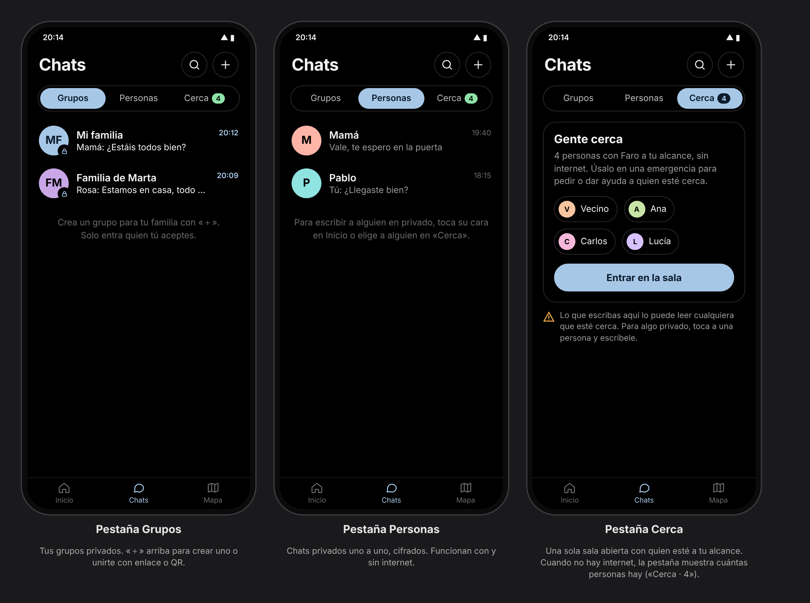

- Título «Chats» con lupa (buscar) y «＋» (crear grupo, unirse con enlace o QR).
- Tres pestañas: **Grupos** (privados, con candado y el color del grupo), **Personas** (chats privados uno a uno) y **Cerca**.
- **Cerca** es una sola sala abierta, «Gente cerca», con quien esté al alcance de la malla (sin internet). Muestra cuántas personas hay y quiénes, y avisa de que lo escrito ahí lo lee cualquiera cerca. La pestaña muestra el número de personas al alcance («Cerca · 4»).
- **Se quitan los canales públicos por zona (geohash):** solo funcionaban con internet, justo cuando no hacen falta, y exponían la IP y la zona. Internet queda para grupos y chats privados, ubicación de la familia y actualizaciones.

### Cerca y sala «Gente cerca» (aprobada)

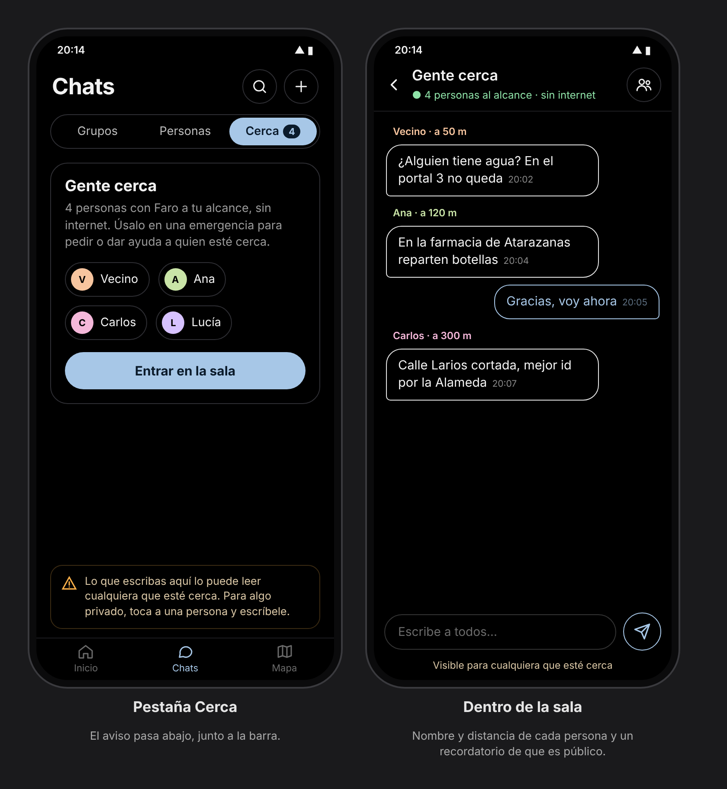

- El aviso de que es público va abajo, pegado a la barra de navegación.
- Dentro de la sala: nombre y **distancia** de cada persona sobre su mensaje; botón para ver la lista de personas y escribir en privado; recordatorio «Visible para cualquiera que esté cerca» bajo el campo de escribir.

## 3. Conversación (aprobada)

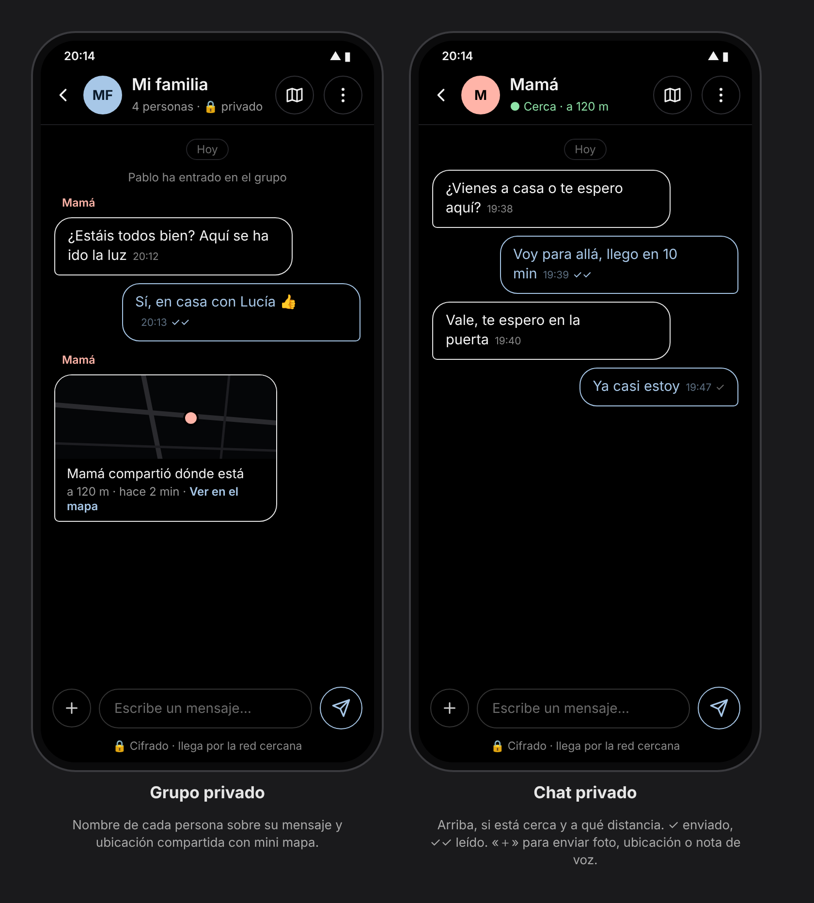

- Cabecera: volver, foto y nombre, botón de mapa y menú ⋮. En grupos, «N personas»; en privados, si está cerca y a qué distancia (en verde).
- Burbujas con borde (los demás a la izquierda en blanco, tú a la derecha en azul calma), nombre en color sobre cada mensaje en grupos, ✓ enviado y ✓✓ leído, avisos del grupo en gris centrados, ubicación compartida como tarjeta con mini mapa.
- Abajo: «＋» (foto, ubicación, nota de voz), campo de texto y enviar; línea «🔒 Cifrado · llega por la red cercana / por internet».
- **Sin mensajes predefinidos** (ni aquí ni en «Gente cerca»).
- Grupos de cualquier tamaño, con un máximo propuesto de 50 personas para no saturar la red cercana. En Inicio, si no caben las caras, «+N».

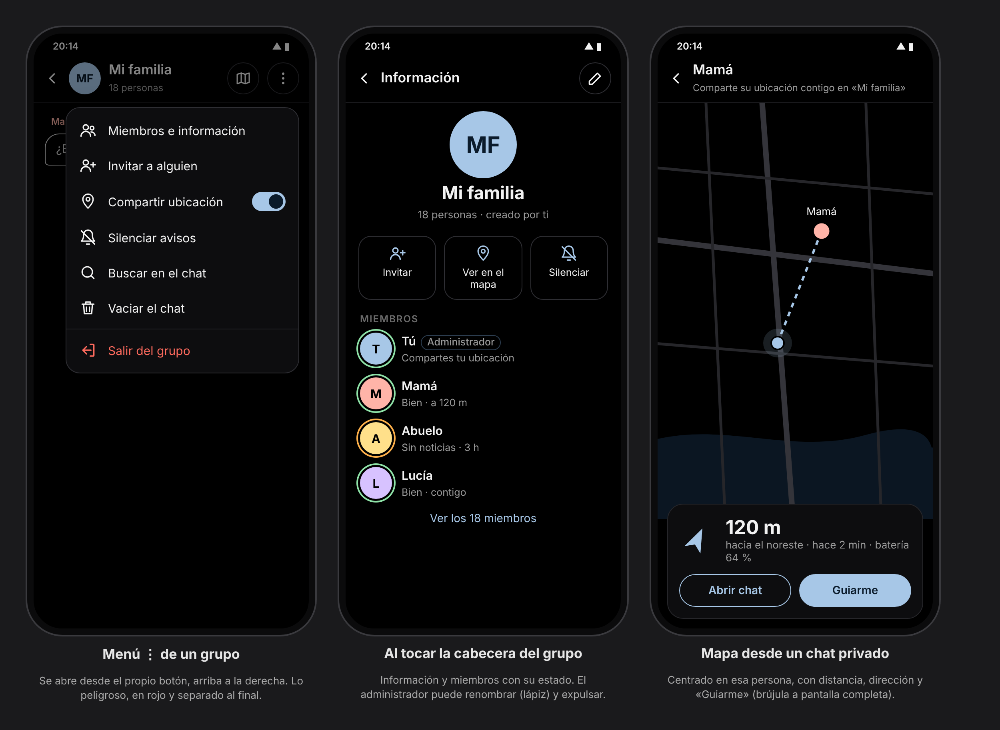

- **Menú ⋮:** se despliega desde el propio botón (arriba a la derecha), no desde abajo. Grupo: Miembros e información, Invitar, Compartir ubicación (interruptor), Silenciar, Buscar, Vaciar el chat y, separado en rojo, Salir del grupo. Privado: Silenciar, Buscar, Verificar identidad, Vaciar el chat y, en rojo, Bloquear.
- **Tocar la cabecera del grupo:** información con foto, nombre, «N personas · creado por…», botones Invitar / Ver en el mapa / Silenciar y lista de miembros con estado y distancia. Solo el administrador cambia nombre y color (lápiz) y expulsa (mantener pulsado); al expulsar, el grupo cambia de clave.
- **Mapa desde un chat privado:** centrado en esa persona, con línea entre ambos, distancia, dirección, hace cuánto y batería; «Abrir chat» y «Guiarme» (brújula a pantalla completa). Solo aparece si esa persona comparte su ubicación contigo en algún grupo.

## 4. Mapa (aprobada)

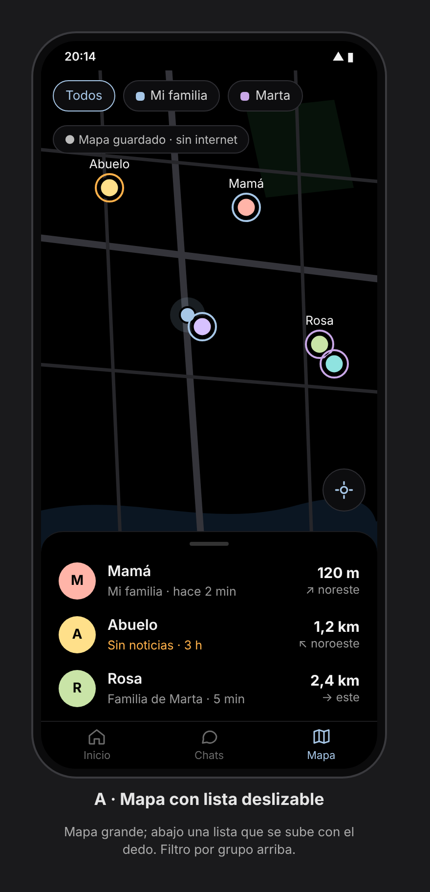

- Mapa grande con todas las personas de tus grupos; aro del color de su grupo (naranja si no hay noticias) y nombre.
- Filtros arriba: Todos / cada grupo con su color. Etiqueta de estado («Mapa guardado · sin internet»).
- Botón para centrarte en ti.
- Abajo, lista deslizable (se sube con el dedo) con nombre, grupo, hace cuánto, distancia y dirección.
- Tocar a alguien: ficha con distancia, dirección, «Abrir chat» y «Guiarme» (brújula a pantalla completa).

## 5. Ajustes (aprobada)

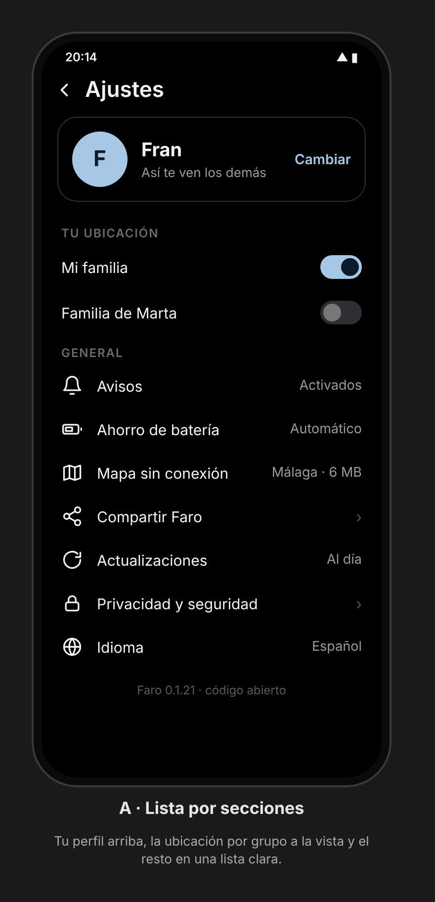

- Perfil arriba (inicial, nombre, «Así te ven los demás», «Cambiar»): aquí se cambia el nombre.
- «Tu ubicación»: un interruptor por grupo, a la vista.
- General, con el estado a la derecha: Avisos, Ahorro de batería, Mapa sin conexión (zona y tamaño), Compartir Faro, Actualizaciones, Privacidad y seguridad, Idioma.
- Pie: versión y «código abierto».

## 6. Crear grupo, invitar y entrar (aprobado)

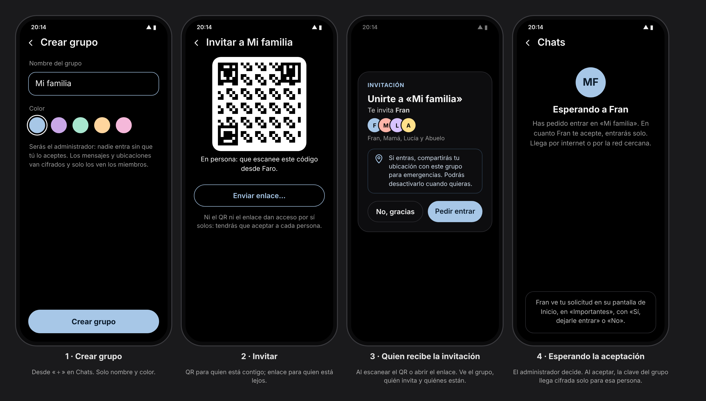

1. **Crear grupo** (desde «＋» en Chats): nombre y color (5 pastel). Quien lo crea es el administrador.
2. **Invitar:** QR grande para quien está contigo y botón «Enviar enlace…», que abre el **menú nativo de compartir** de Android (WhatsApp, Telegram, SMS…). Ni el QR ni el enlace dan acceso por sí solos.
3. **Quien recibe la invitación** (QR o enlace): ventana con el grupo, quién invita, caras y nombres de quienes están, aviso de que compartirá su ubicación para emergencias (desactivable) y «No, gracias» / «Pedir entrar».
4. **Esperando la aceptación:** «Esperando a Fran…». El administrador lo ve en Inicio › Importantes con «Sí, dejarle entrar» / «No». Al aceptar, la clave del grupo llega cifrada solo para esa persona.
- **Cambio de seguridad:** el QR ya no da acceso inmediato; también necesita la aceptación del administrador.

## 7. Bienvenida y permisos (aprobado)

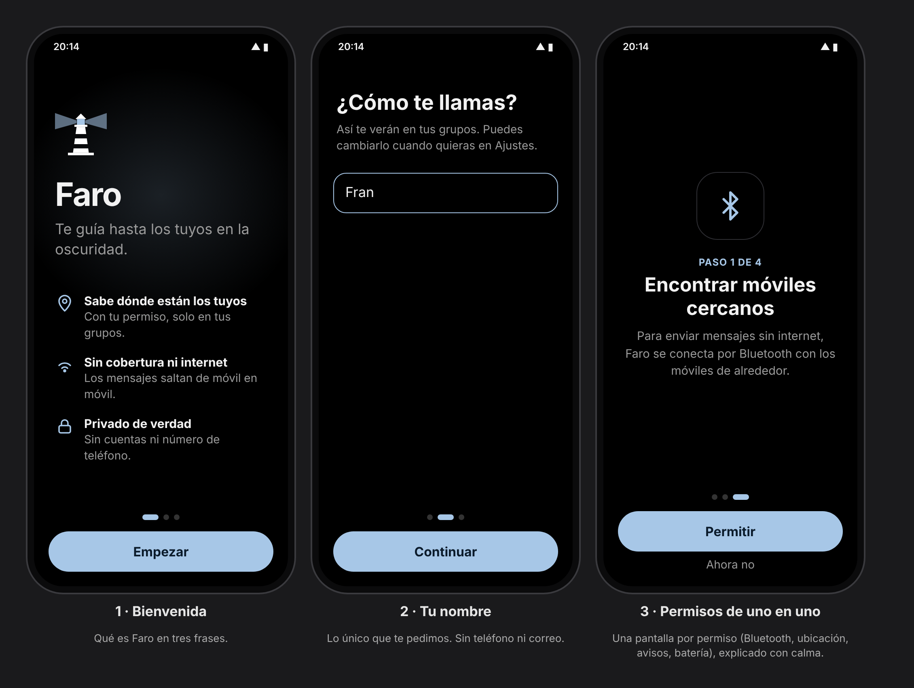

1. **Bienvenida:** faro, «Faro», lema y tres frases (Sabe dónde están los tuyos · Sin cobertura ni internet · Privado de verdad). «Empezar».
2. **Tu nombre:** «¿Cómo te llamas?». Lo único que se pide; se cambia luego en Ajustes.
3. **Permisos de uno en uno:** una pantalla por permiso con icono grande, «Paso N de 4», explicación sencilla, «Permitir» y «Ahora no»: móviles cercanos (Bluetooth), ubicación, avisos y funcionar en segundo plano.

## 8. Pantallas menores

### Primera tanda

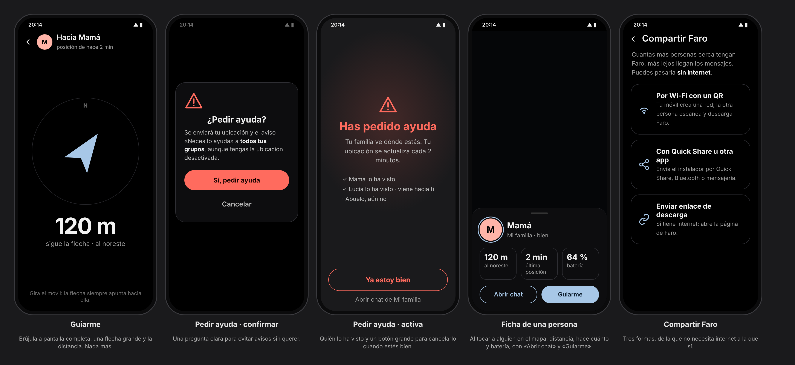

- «Guiarme»: brújula a pantalla completa con la distancia hasta la persona.
- «Pedir ayuda»: primero se confirma y después queda una pantalla activa con la opción de cancelar.
- Ficha de una persona en el mapa y pantalla «Compartir Faro».

### Segunda tanda

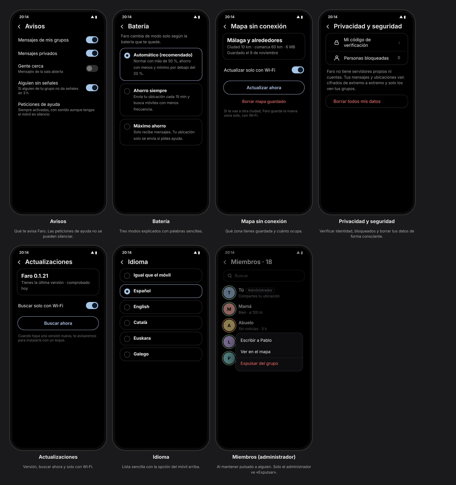

- **Avisos:** un interruptor por tipo de aviso. Las peticiones de ayuda no se pueden silenciar y suenan aunque el móvil esté en silencio.
- **Batería:** tres modos (Automático, Ahorro siempre y Máximo ahorro), cada uno explicado con palabras sencillas.
- **Mapa sin conexión:** la zona guardada y cuánto ocupa, «Actualizar solo con Wi‑Fi», «Actualizar ahora» y «Borrar mapa guardado».
- **Privacidad y seguridad:** mi código de verificación, personas bloqueadas y «Borrar todos mis datos», que pide confirmación.
- **Actualizaciones:** versión instalada, «Buscar solo con Wi‑Fi» y «Buscar ahora».
- **Idioma:** «Igual que el móvil» arriba y debajo los idiomas.
- **Miembros:** buscador, etiqueta de administrador y menú al mantener pulsado (Escribir, Ver en el mapa y, solo para el administrador, Expulsar del grupo).

### Ficha con la calle y «Seguir en directo»

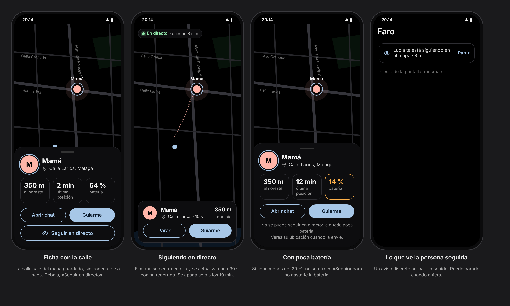

- **Calle:** se saca del mapa guardado (nombres de calle de los datos del mapa), sin conectarse a ningún servicio. Fuera de la zona guardada y sin internet, se muestra solo la distancia. No se usa el buscador de direcciones de Android porque enviaría la ubicación a Google.
- **Seguir en directo:** pide al móvil de esa persona que envíe su ubicación cada 30 s durante 10 min; después vuelve solo a su ritmo normal (5 o 15 min según batería). El mapa se centra en ella y dibuja su recorrido.
- **Batería:** no se ofrece si a esa persona le queda menos del 20 %. Gasta algo más solo durante esos 10 min y se apaga sola.
- **La persona seguida** ve un aviso discreto, sin sonido («Lucía te está siguiendo en el mapa · 8 min») con «Parar».

### Aviso «han visto dónde estás»

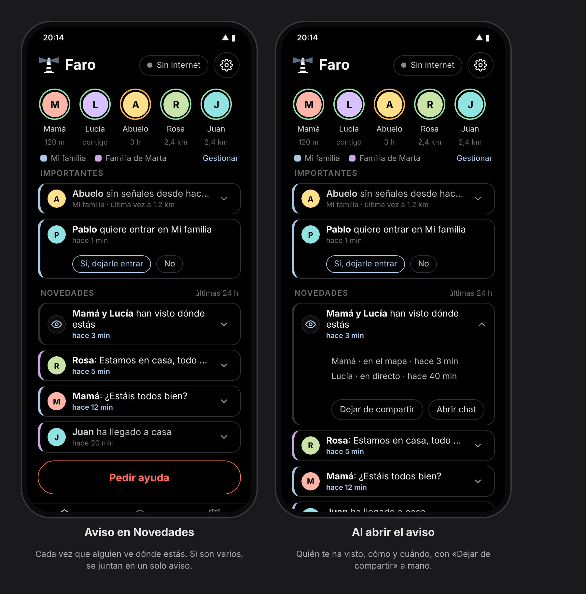

- Cuando alguien abre el mapa y te ve, abre tu ficha, te guía o te sigue en directo, su móvil envía un aviso pequeño («visto») **solo por internet** (Nostr), nunca por la malla. Si en ese momento no tiene internet, el aviso sale cuando lo recupere (como mucho 24 h después).
- A ti te llega como una notificación normal y queda también en Novedades.
- En Inicio aparece en Novedades: «Mamá y Lucía han visto dónde estás». Varios avisos se juntan en uno. Al abrirlo se ve quién, cómo (en el mapa, en directo) y cuándo, con «Dejar de compartir» y «Abrir chat».
- **Batería:** gasto despreciable: es un mensaje de unos pocos bytes por una conexión que ya está abierta, como mucho uno por persona cada 15 min, y no ocupa la radio Bluetooth.
- Es un aviso de buena fe: el móvil de tu familia ya tiene tu ubicación al recibirla, así que avisa de lo que se ve dentro de Faro.
